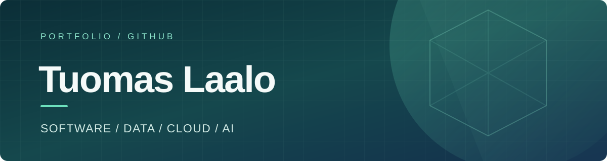
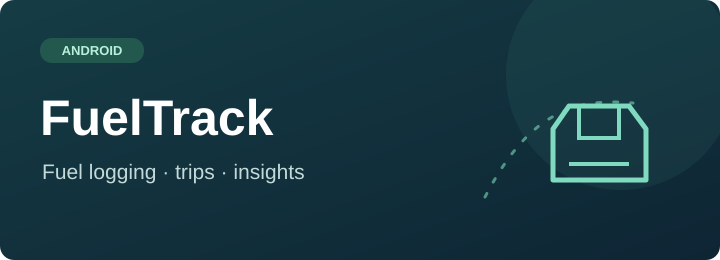
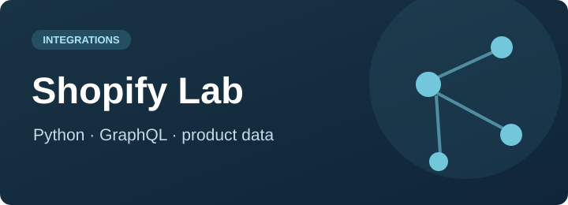

 

**I build practical things, explore complex systems, and enjoy figuring out how technology connects.**

Business IT student at Haaga-Helia University of Applied Sciences · Helsinki, Finland

[**Explore projects ↓**](#selected-work) · [**GitHub repositories ↗**](https://github.com/TuomasLaalo?tab=repositories)

 

### 01 / About

My interests span software engineering, data, integrations, cloud infrastructure, and AI-assisted development. I enjoy turning an idea into something usable from mobile applications to API experiments and learning the engineering decisions behind the result.

### 02 / Tools & technologies

 

Also working with Jetpack Compose · Room · SQL · GraphQL · REST APIs

 

### 03 / Selected work

<table>
<tr>
<td width="50%" valign="top">
  
  <h3><a href="https://github.com/TuomasLaalo/FuelTrack">FuelTrack ↗</a></h3>
  
Local-first Android app for fuel purchases, costs and trips, with a focus on dependable calculations and maintainable architecture.

  <strong>Kotlin · Jetpack Compose · Room · Testing</strong>
</td>
<td width="50%" valign="top">
  
  <h3><a href="https://github.com/TuomasLaalo/shopify-integration-lab">Shopify Integration Lab ↗</a></h3>
  
A hands-on integration project exploring Shopify product, variant and inventory data through its GraphQL API.

  <strong>Python · GraphQL · API integrations</strong>
</td>
</tr>
</table>

**Also exploring:** RunTrack — an Android project for importing and analyzing Polar training data, statistics and comparisons.

### 04 / Currently exploring

**Systems & integrations** — how applications exchange, transform and validate data  
**Data & infrastructure** — SQL, Linux, backend services and cloud fundamentals  
**AI-assisted development** — practical ways to use coding agents in real software projects

 

  Curious about how things work. Interested in building what comes next.

